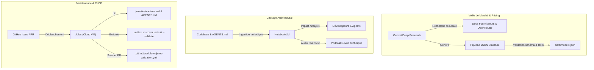

# Intégration de l'Écosystème Google AI Pro dans OpenCode-ModelPool 🚀

Ce répertoire formalise l'intégration, les points de contact et les protocoles de délégation d'**OpenCode-ModelPool** avec l'écosystème d'outils avancés **Google AI Pro** :
- **Gemini Deep Research** : Veille de marché autonome, benchmarks de tarification multi-fournisseurs et surveillance des quotas.
- **NotebookLM** : Mémoire architecturale continue sans hallucination, évaluation comparative des nouvelles parutions et synthèses audio techniques (Audio Overview).
- **Jules (Google Labs)** : Agent de codage autonome opérant dans le cloud GitHub pour la relecture de PR, la reproduction de bugs et l'implémentation de correctifs auto-validés.
- **Antigravity** : Environnement d'orchestration multi-agents local pilotant le développement et le maintien des invariants logiciels.

---

## 🎯 Philosophie & Préservation des Invariants Architecturaux

Le cœur applicatif d'OpenCode-ModelPool (`src/`) applique une règle fondamentale de résilience et de légèreté :
> **Zéro dépendance externe au runtime et séparation stricte des fonctions pures et des I/O.**

Plutôt que d'intégrer des scrapers réseau fragiles, des bibliothèques de parsing tierces ou des dépendances lourdes pour surveiller le marché des LLMs :
1. **La veille et l'analyse de marché sont déléguées à Gemini Deep Research.** Les résultats sont exportés sous forme structurée validée par un schéma JSON strict (`schemas/benchmark_output.schema.json`).
2. **La mémoire d'architecture et l'impact des évolutions sont délégués à NotebookLM.** Les documents de référence du dépôt (`AGENTS.md`, `README.md`, configurations) y sont ingérés pour garantir des réponses ancrées à 100% sans hallucination.
3. **La maintenance continue et la relecture CI/CD sont déléguées à Jules.** Jules opère dans des machines virtuelles isolées sur GitHub, applique strictement les règles d'architecture via `.jules/instructions.md` et fait valider son travail par la CI `.github/workflows/jules-validation.yml`.

Cette conception permet au projet d'exécuter l'intégralité de sa suite de tests en **moins de 0,3 seconde** sans aucun appel réseau intempestif.

---

## 🗺️ Cartographie des Modules

```text
docs/google_ai_pro/
├── README.md                              # Vue d'ensemble (ce document)
├── deep_research/                         # Gemini Deep Research
│   ├── README.md                          # Guide opérationnel & points de contact
│   ├── prompts/
│   │   ├── pricing_benchmark.md           # Benchmark exhaustif des tarifs ($/1M tokens)
│   │   ├── provider_updates.md            # Surveillance des endpoints, modèles et dépréciations
│   │   └── token_monitoring.md            # Surveillance des quotas et rate-limits free-tier
│   ├── schemas/
│   │   └── benchmark_output.schema.json   # Schéma JSON conforme à Model (selector.py)
│   └── workflows/
│       └── ingestion_procedure.md         # Procédure de validation et fusion dans models.json
├── notebooklm/                            # NotebookLM
│   ├── README.md                          # Guide de cadrage architectural & radar modèles
│   ├── source_ingestion_guide.md          # Guide d'ingestion des sources (limites 500k mots)
│   ├── prompts/
│   │   ├── architecture_grounding.md      # Requêtes d'analyse d'impact et d'invariants
│   │   ├── model_release_eval.md          # Grille d'évaluation des nouveaux modèles
│   │   └── audio_overview_brief.md        # Canevas pour podcast technique 2 voix
│   └── sources/
│       └── curated_sources.json           # Liste officielle des sources et flux à ingérer
└── jules/                                 # Jules (Google Labs Coding Agent)
    ├── README.md                          # Guide de configuration & délégation Jules
    ├── jules_instructions.md              # Instructions pour le VM Jules en cloud
    └── prompts/
        ├── pr_review_prompt.md            # Prompt de relecture automatique de PR
        └── bugfix_workflow.md             # Protocole de reproduction et résolution de bug
```

---

## 🔄 Flux d'Intégration et Synergies



---

## ⚡ Guide de Démarrage Rapide

1. **Pour lancer un audit de prix LLM :**
   Utilisez le prompt [`deep_research/prompts/pricing_benchmark.md`](deep_research/prompts/pricing_benchmark.md) dans Gemini Advanced / Deep Research, puis appliquez la procédure [`deep_research/workflows/ingestion_procedure.md`](deep_research/workflows/ingestion_procedure.md).
2. **Pour interroger l'architecture sans hallucination :**
   Créez un carnet dans NotebookLM en suivant le guide [`notebooklm/source_ingestion_guide.md`](notebooklm/source_ingestion_guide.md) avec les sources listées dans [`notebooklm/sources/curated_sources.json`](notebooklm/sources/curated_sources.json).
3. **Pour déléguer un ticket à Jules sur GitHub :**
   Attribuez le label `jules` à l'issue GitHub ou commentez `/jules fix` selon le protocole [`jules/prompts/bugfix_workflow.md`](jules/prompts/bugfix_workflow.md).
