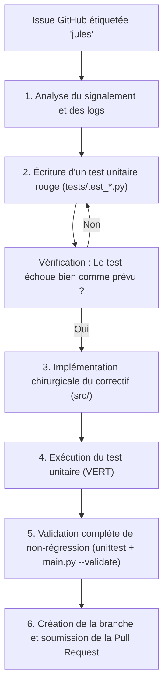

# Protocole Jules : Reproduction et Résolution Autonome de Bogues (Bugfix Workflow) 🪲

Ce protocole décrit la démarche pas-à-pas que l'agent **Jules** exécute lorsqu'un ticket GitHub (Issue) lui est délégué (via le label `jules` ou la commande `/jules fix`).

---

## 🧭 Vue d'Ensemble du Cycle TDD Autonome



---

## 📋 Déroulé Opérationnel

### Étape 1 : Diagnostic & Analyse de la Cause Racine
1. Lisez la description du problème dans l'Issue GitHub.
2. Identifiez le composant responsable :
   - `src/selector.py` : Erreur de filtrage, pondération, tri ou calcul de complexité.
   - `src/exporter.py` : Structure JSON non conforme, mauvais préfixe de fournisseur.
   - `src/budget.py` : Calcul de coût erroné ou seuil d'alerte incorrect.
   - `src/providers/` : Détection de clés, sondes réseau ou routage.
   - `src/service.py` : Concurrence, verrous ou gestion de fichiers.
   - `main.py` : Parsing d'arguments CLI ou codes de sortie.

### Étape 2 : Création de la Branche de Travail
Dans la machine virtuelle cloud Jules :
```bash
git checkout -b jules/fix-issue-${ISSUE_NUMBER}-${SHORT_SLUG}
```

### Étape 3 : Écriture du Test de Non-Régression (Phase Rouge)
Avant toute modification du code source, écrivez un test unitaire qui échoue dans le fichier de test approprié (`tests/test_*.py`).
Exécutez le test pour prouver qu'il échoue :
```bash
python3 -m unittest tests/test_<nom_du_module>.py -k <nom_du_nouveau_test>
```
*Le test doit impérativement lever une assertion.*

### Étape 4 : Implémentation Minimale du Correctif (Phase Verte)
1. Modifiez uniquement les lignes strictement requises dans `src/`.
2. Respectez scrupuleusement la pureté des fonctions et l'interdiction de dépendances tierces.
3. Ré-exécutez le test spécifique :
```bash
python3 -m unittest tests/test_<nom_du_module>.py -k <nom_du_nouveau_test>
```
*Le test doit maintenant passer avec succès.*

### Étape 5 : Exécution de la Suite Complète & Contrôle de Non-Régression
Validez l'intégrité globale du dépôt :
```bash
# 1. Tous les tests unitaires doivent réussir
python3 -m unittest discover tests

# 2. La validation du parc complet d'agents doit être conforme
python3 main.py --validate

# 3. Contrôles statiques
python3 -m ruff check .
python3 -m mypy .
```

### Étape 6 : Publication de la Pull Request
1. Committez vos modifications avec un message respectant Conventional Commits :
   ```bash
   git add tests/ src/
   git commit -m "fix(<composant>): <description concise du correctif> (fixes #${ISSUE_NUMBER})"
   ```
2. Ouvrez la Pull Request en utilisant ce modèle de description :

```markdown
## 🛠️ Résolution Autonome Jules : Issue #${ISSUE_NUMBER}

### Problème Initial
${SUMMARY_OF_ISSUE}

### Cause Racine
${ROOT_CAUSE_ANALYSIS}

### Modifications Réalisées
- **Test de non-régression** : Ajout de \`${TEST_NAME}\` dans \`${TEST_FILE}\`.
- **Correctif** : Modification chirurgicale dans \`${FIXED_FILE}\`.

### Résultats des Vérifications
- [x] \`python3 -m unittest discover tests\` : 100% OK
- [x] \`python3 main.py --validate\` : Configuration valide pour tous les agents
- [x] \`ruff check .\` et \`mypy .\` : Aucun avertissement
- [x] Invariants architecturaux respectés (zéro I/O dans modules purs, zéro dépendance externe)
```
